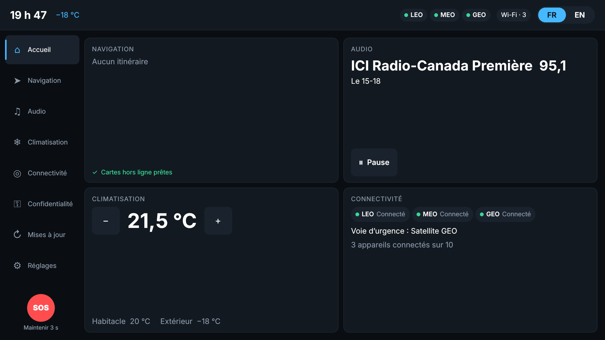
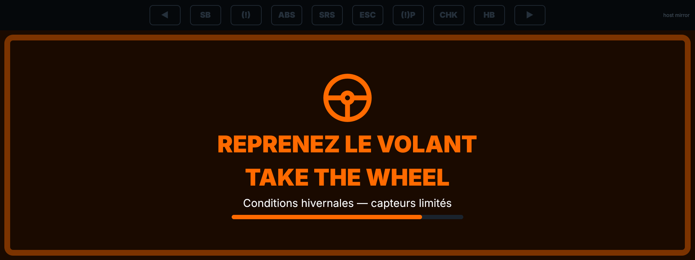

# CIVI cockpit front-end — reference code base (draft v0.1)

Front-end for the **Canadian In-Vehicle Infotainment (CIVI)** reference architecture,
built from *CIVI High-Level System Requirements v1.1*. Foundation OS: **QNX SDP 8.0**.
Target: **Qualcomm Snapdragon cockpit platforms** (SA8295P / SA8775P class) or
equivalent. The same tree builds and runs as a desktop simulator on Linux, so it can
be demonstrated before a board is available.

| Display | Process | Partition on target |
|---|---|---|
| Cluster telltales | `civi-telltaled` (C, CPU-rendered, top z-order) | Cluster (QNX OS for Safety) |
| Instrument cluster 1920×720 | `civi-cluster` (Qt Quick) | Cluster |
| Head-up display 1280×480 | `civi-hud` | Cluster |
| Centre display 1920×1080 | `civi-center` | Infotainment |
| Passenger display 1920×1080 | `civi-passenger` | Infotainment |




## What this draft demonstrates
* **Separate trusted from delightful (P1)** — one process per display; telltales drawn by
  a tiny C renderer with no Qt or GPU dependency, with heartbeat fail-safe; any display
  can crash and restart without affecting the cluster.
* **French parity as a system property (P2)** — one string catalogue, French authored
  first; cockpit-wide language switch; Quebec defaults to French; Canadian French
  formats (« 14 h 05 », « 2,5 km », « −24 °C »); a CI gate that blocks releases with
  untranslated or hard-coded strings.
* **Complete without the network (P4)** — satellite-first status (LEO/MEO/GEO,
  terrestrial optional), GEO → LEO → terrestrial emergency fallback, offline banner
  that says what still works, stale-data detection everywhere.
* **Occupant owns the data (P5)** — per-purpose, per-profile consent, most-protective
  defaults, Canadian residency, factory reset.
* **Know where every component came from (P6)** — CycloneDX SBOM with supplier and
  origin per build; US BIS connected-vehicle provenance gate.
* **Build for the next layer (P7)** — AV status and bilingual takeover request on
  cluster + HUD, with on-frame latency measurement against the configured budget.
* **Every TBD is configuration** — the front-end-relevant open values (TBD-4, -5, -7,
  -8, -11, -12, -15) live in `config/civi-config.json`; nothing is hard-coded.

Requirement-by-requirement status: [`docs/TRACEABILITY.md`](docs/TRACEABILITY.md).

## Quick start (Linux desktop)
```bash
sudo apt-get install cmake g++ qt6-declarative-dev qt6-tools-dev \
  qml6-module-qtquick qml6-module-qtqml-workerscript qml6-module-qtquick-window fonts-inter
cmake -B build -S . && cmake --build build -j
(cd build && ctest --output-on-failure)     # unit tests + French-parity + SBOM gates
tools/run-desktop.sh full-demo               # simulator + all displays
```
Scenarios: `parked`, `winter-drive`, `tunnel`, `takeover`, `wildfire`, `crash`,
`full-demo` (`python3 tools/vsim/civi_vsim.py --list`). Talk track:
[`docs/DEMO_SCRIPT.md`](docs/DEMO_SCRIPT.md).

Screenshots of every display × scenario × language: `tools/screenshots.sh`
(output in `docs/screenshots/`).

## On QNX SDP 8.0 / Snapdragon
See [`docs/QNX_QUALCOMM_BRINGUP.md`](docs/QNX_QUALCOMM_BRINGUP.md): cross-build with
`cmake/qnx-sdp8-aarch64le.cmake`, display mapping, start order
(`deploy/qnx/civi-startup.sh`), security-policy sketch, and the first measurements
to take on the board.

## Repository layout
```
platform/        Qt-Core services: vehicle API client, distraction policy, alerts,
                 locale, connectivity, emergency, consent, OTA, nav, media
hmi/             runtime + CIVI.Controls + cluster / center / passenger / hud apps
safety/          civi-telltaled (C)
i18n/            catalog_src.py → catalog.json (single FR/EN source)
config/          runtime configuration, consent policy, compliance rules
tools/           vsim simulator, i18n parity gate, SBOM gate, screenshots, desktop runner
deploy/qnx/      start-up script, IFS fragment, secpol sketch
docs/            architecture, API contract, traceability, bring-up, demo script
```
Architecture and design rationale: [`docs/ARCHITECTURE.md`](docs/ARCHITECTURE.md).
Vehicle-services contract: [`docs/VEHICLE_SERVICES_API.md`](docs/VEHICLE_SERVICES_API.md).

## What is real and what is stubbed
| Real (built, run, tested here) | Stubbed or simulated |
|---|---|
| All QML displays, platform services, alert arbitration, distraction policy, locale, consent, OTA gating | Vehicle-services server, TCU, nav engine, tuner, OTA client — simulated by `tools/vsim` over the same PPS contract |
| Telltale state machine and heartbeat fail-safe (host build + unit test) | QNX Screen back-end of `civi-telltaled` — written against the Screen API, **not yet compiled or run on SDP 8.0** |
| French-parity and SBOM/BIS gates in CI | Speech (ASR/TTS) engine — requests are published, engine TBD |
| PPS transport on Linux (file-backed) | PPS transport on QNX (`?delta` + notifier) — **not yet run on target** |
| | Map rendering (placeholder canvas), passenger video surface, CarPlay/Android Auto |
| | Toolchain file, start-up script and `secpol` — need validation on a licensed SDP 8.0 |

Built and verified on Linux with Qt 6.4 (host). Target code paths are guarded by
`CIVI_TARGET_QNX` / `__QNX__`.

## Next steps toward a programme
1. Bring up on a Snapdragon cockpit board with the QNX 8.0 BSP; measure telltale and
   first-frame timing, takeover latency, and restart isolation (bring-up guide §6).
2. Replace `tools/vsim` objects one by one with the real vehicle-services server and TCU.
3. Choose the speech vendor (fr-CA / en-CA, code-switching) and wire TTS/ASR.
4. Map rendering partner, CarPlay/Android Auto stacks, OEM design language.
5. Close the front-end TBDs (TBD-3, -5, -7, -11, -15) and the infotainment-ecosystem
   decision (§12.1); TARA for the HMI attack surface (SEC-007).
